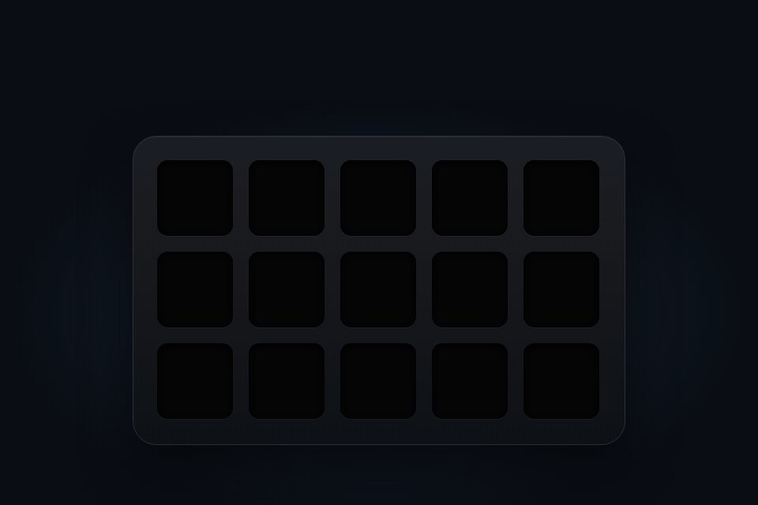
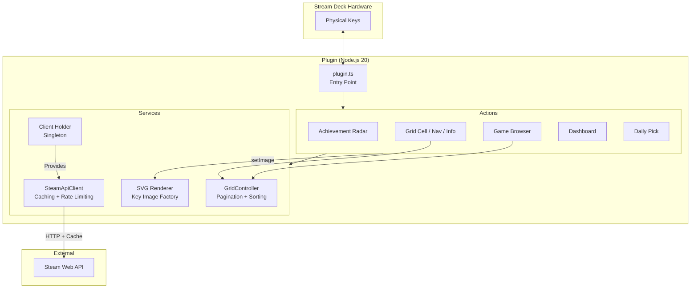

<h1 align="center">Steam Achievement Hunter</h1>

<p align="center">
  <b>Your Steam achievements, live on your Elgato Stream Deck.</b><br/>
  Auto-detects the game you're playing, shows every achievement color-coded by rarity, and lights up the moment one unlocks.
</p>

<p align="center">
  <a href="https://github.com/SantosMaxime/Streamdeck-Steam-Achievements/releases/latest"></a>
  <a href="https://github.com/SantosMaxime/Streamdeck-Steam-Achievements/actions/workflows/ci.yml"></a>
  
  
  <a href="LICENSE"></a>
</p>

<p align="center">
  
</p>

<p align="center">
  <a href="https://github.com/SantosMaxime/Streamdeck-Steam-Achievements/releases/latest"><b>Download</b></a> ·
  <a href="#features">Features</a> ·
  <a href="#getting-started">Getting started</a> ·
  <a href="#development">Development</a>
</p>

---

## Features

- **Achievement Radar.** Detects the Steam game you're running and shows the next locked achievement with your progress. Press it to open a guide.
- **Achievement Grid.** Turns the whole deck into a paged gallery of every achievement for a game. Locked ones are dimmed and every key carries a rarity stripe.
- **One-press sorting.** The progress key cycles between Default, Rarest first, A–Z, Locked only and Unlocked only.
- **Unlock celebration.** When an achievement pops, its key glows gold and the progress ring updates by itself.
- **Game Browser.** Pick any game from your library, or let it use the one you're playing. It switches to the grid profile for you.
- **Dashboard.** Three keys show your Steam level, total achievements and perfect games.
- **Daily Pick.** Suggests one locked achievement to go after each day.
- **Works on every Stream Deck size.** Grid profiles ship for Standard, Mini, XL, and + / Neo.

### Rarity colors

Each key is colored by the share of players who unlocked that achievement:

| Rarity | Unlocked by | Color |
|--------|-------------|-------|
| **Legendary** | < 1% |  Gold |
| **Ultra Rare** | 1–5% |  Purple |
| **Rare** | 5–20% |  Blue |
| **Uncommon** | 20–50% |  Green |
| **Common** | > 50% |  Gray |

---

## Getting started

**You need:** Windows 10+, [Stream Deck software 6.6+](https://www.elgato.com/downloads), a free [Steam Web API key](https://steamcommunity.com/dev/apikey) and your [64-bit Steam ID](https://steamid.io/). Your Steam profile and game details must be public for the API to return achievements.

1. Download the latest `.streamDeckPlugin` from [Releases](https://github.com/SantosMaxime/Streamdeck-Steam-Achievements/releases/latest).
2. Double-click it to install it in Stream Deck.
3. Drag the **Settings** action onto a key, then enter your API key and Steam ID. The key turns green once the connection works.
4. Add the **Achievement Radar** and **Game Browser** actions, launch a game, and start hunting.

---

## Development

```bash
git clone https://github.com/SantosMaxime/Streamdeck-Steam-Achievements.git
cd Streamdeck-Steam-Achievements
npm install
streamdeck link com.maxik.steam-achievements.sdPlugin   # one-time, then restart Stream Deck
npm run watch                                          # rebuild + restart the plugin on save
```

See [CONTRIBUTING.md](CONTRIBUTING.md) for the workflow, coding conventions and PR guidelines.

<details>
<summary><b>Full setup notes and scripts</b></summary>

#### Development Setup

```bash
# Clone the repository
git clone https://github.com/SantosMaxime/Streamdeck-Steam-Achievements.git
cd Streamdeck-Steam-Achievements

# Install dependencies
npm install

# Register plugin with Stream Deck (one-time, required!)
# This makes the plugin visible in Stream Deck software
streamdeck link com.maxik.steam-achievements.sdPlugin

# Then close and reopen Stream Deck software completely
# The plugin should now appear in the sidebar
```

Once registered, you can start development:

```bash
# Run tests
npm test

# Build the plugin
npm run build

# Watch mode (auto-rebuilds + restarts Stream Deck plugin on file changes)
npm run watch

# In another terminal, run the terminal-based radar simulator
npm run simulate
```

**⚠️ Important:** The `streamdeck link` command is **required once** before the plugin will appear in Stream Deck. Without it, the plugin exists only in your source code but isn't visible to the app.

**If the plugin is already installed:**
- If you see `✖️ Plugin already installed: com.maxik.steam-achievements`, first unlink the old version:
  ```bash
  streamdeck unlink com.maxik.steam-achievements
  streamdeck link com.maxik.steam-achievements.sdPlugin
  ```
- Or if the plugin is already showing in Stream Deck, just run `npm run watch` directly — it will restart the already-registered plugin automatically.

#### Available Scripts

| Script | Description |
|--------|-------------|
| `npm run build` | Bundle TypeScript into `sdPlugin/bin/plugin.js` via Rollup |
| `npm run watch` | Dev mode with auto-rebuild and Stream Deck restart |
| `npm test` | Run Vitest test suite |
| `npm run test:watch` | Run tests in watch mode |
| `npm run simulate` | Launch terminal-based radar simulator |
| `npm run gen-icons` | Regenerate all PNG icons via software rasterizer |
| `npm run gen-profiles` | Regenerate `.streamDeckProfile` bundles |
| `npm run package` | Full release pipeline: icons + profiles + build + pack |
| `npm run bump <patch\|minor\|major>` | Bump version in package.json + manifest.json, update CHANGELOG, commit |

#### Stream Deck CLI Commands

| Command | Description |
|---------|-------------|
| `streamdeck link com.maxik.steam-achievements.sdPlugin` | **[Required]** Register the plugin with Stream Deck (one-time) |
| `streamdeck restart com.maxik.steam-achievements` | Restart the plugin (used by `npm run watch`) |
| `streamdeck stop com.maxik.steam-achievements` | Stop the plugin |
| `streamdeck unlink com.maxik.steam-achievements` | Unregister the plugin from Stream Deck |
| `streamdeck list` | List all installed plugins |
| `streamdeck validate com.maxik.steam-achievements.sdPlugin` | Validate plugin structure and manifest |

</details>

<details>
<summary><b>Architecture</b></summary>



</details>

<details>
<summary><b>Project structure</b></summary>

```
Streamdeck-Steam-Achievements/
├── src/
│   ├── plugin.ts                      # Entry point — registers actions, starts game watcher
│   ├── actions/
│   │   ├── achievement-radar.ts       # Auto-detect game, show next locked achievement
│   │   ├── daily-pick.ts             # Deterministic daily random achievement
│   │   ├── dashboard.ts              # Level, Total Achievements, Perfect Games
│   │   ├── game-browser.ts           # Game picker with auto-detect + profile switch
│   │   ├── grid-cell.ts              # Individual achievement tile in the grid
│   │   ├── grid-info.ts              # Progress ring + sort mode cycling
│   │   └── grid-nav.ts              # Prev / Next / Back navigation
│   ├── services/
│   │   ├── steam-api.ts              # Steam Web API client with caching
│   │   ├── steam-client-holder.ts    # Global singleton for SteamApiClient
│   │   ├── grid-controller.ts        # Grid state: pagination, sorting, broadcasting
│   │   └── svg-renderer.ts           # SVG image generators for all key displays
│   ├── simulator/
│   │   └── simulate.ts               # Terminal-based radar scenario simulator
│   └── __tests__/
│       ├── achievement-radar.test.ts  # Radar lifecycle, celebration, guide button
│       ├── grid-controller.test.ts    # Pagination, sorting, stats, loadGame
│       └── svg-renderer.test.ts       # Rarity info, all SVG render functions
├── scripts/
│   ├── generate-icons.ts             # Pure Node.js PNG rasterizer for all plugin icons
│   ├── gen-profiles.mjs              # Generates .streamDeckProfile ZIP bundles
│   ├── bump-version.mjs             # Syncs version across package.json + manifest.json
│   └── demo/render-demo.ts          # Renders docs/demo.gif from the real key renderer
├── docs/
│   └── demo.gif                      # README demo
├── com.maxik.steam-achievements.sdPlugin/
│   ├── manifest.json                 # Stream Deck SDK v2 plugin manifest
│   ├── bin/                          # Build output (gitignored)
│   ├── imgs/                         # Generated PNG icons (1x + @2x)
│   ├── profiles/                     # Generated .streamDeckProfile bundles
│   └── ui/                           # Property Inspector HTML files
├── .github/
│   ├── workflows/
│   │   ├── ci.yml                    # Lint + Test + Build on push/PR
│   │   └── release.yml               # Auto-package + GitHub Release on tags
│   ├── ISSUE_TEMPLATE/
│   │   ├── bug_report.yml
│   │   └── feature_request.yml
│   └── pull_request_template.md
├── package.json
├── tsconfig.json
├── rollup.config.mjs
├── vitest.config.ts
├── .editorconfig
├── CONTRIBUTING.md
└── CHANGELOG.md
```

</details>

<details>
<summary><b>Versioning and releases</b></summary>

This project uses [Semantic Versioning](https://semver.org/). Versions are tracked in two files:

- `package.json` — Standard 3-part semver (`X.Y.Z`)
- `manifest.json` — Stream Deck 4-part version (`X.Y.Z.0`)

Use the bump script to keep them in sync:

```bash
# Patch release (0.1.1 → 0.1.2)
npm run bump patch

# Minor release (0.1.2 → 0.2.0)
npm run bump minor

# Major release (0.2.0 → 1.0.0)
npm run bump major
```

The script updates both files, appends a blank entry to `CHANGELOG.md`, and creates a `release:` commit on `dev`. Open a PR to `main` — CI will create the git tag and publish the GitHub Release automatically on merge.

| Workflow | Trigger | What it does |
|----------|---------|--------------|
| **CI** | Push/PR to `main` or `dev` | Type-check, test, build |
| **Release** | Push tag `v*` | Test, build, pack `.streamDeckPlugin`, create GitHub Release with artifact |

</details>

<details>
<summary><b>Tech stack</b></summary>

| Layer | Technology |
|-------|------------|
| Language | TypeScript 5.7 |
| Runtime | Node.js 20 (embedded by Stream Deck) |
| SDK | `@elgato/streamdeck` v2 |
| Bundler | Rollup 4 (TypeScript, node-resolve, commonjs, terser) |
| Testing | Vitest 4 |
| Module System | ESM |
| Image Generation | Custom SVG renderer (runtime) + custom PNG rasterizer (build-time) |
| CI/CD | GitHub Actions |

</details>

<details>
<summary><b>Regenerating the demo GIF</b></summary>

`docs/demo.gif` is rendered from the plugin's own SVG key renderer, using a fictional game and placeholder icons, so it needs no Steam account. It requires Playwright (Chromium) and ffmpeg:

```bash
npx tsx scripts/demo/render-demo.ts
```

</details>

---

## License

MIT. See [LICENSE](LICENSE).

<sub>Not affiliated with Valve or Elgato. Steam and Stream Deck are trademarks of their respective owners.</sub>
